# Lumen Óptica — Backend


API REST para la gestión de productos, clientes, pedidos y pagos de **Lumen Óptica**, una óptica que vende anteojos de sol, armazones, lentes de contacto y accesorios.

## Índice

- [Descripción](#descripción)
- [Objetivo](#objetivo)
- [Tecnologías utilizadas](#tecnologías-utilizadas)
- [Estructura del proyecto](#estructura-del-proyecto)
- [Modelos principales](#modelos-principales)
- [Relaciones](#relaciones)
- [Diagrama de modelos](#diagrama-de-modelos)
- [Instalación con uv](#instalación-con-uv)
- [Cómo ejecutar el proyecto](#cómo-ejecutar-el-proyecto)
- [Autenticación](#autenticación)
- [Endpoints principales](#endpoints-principales)
- [Panel de administración](#panel-de-administración)
- [Documentación: Swagger y Redoc](#documentación-swagger-y-redoc)
- [Pruebas](#pruebas)
- [Ejecutar con Docker](#ejecutar-con-docker)
- [Capturas del sistema](#capturas-del-sistema)
- [Flujo de trabajo con Git](#flujo-de-trabajo-con-git)
- [Integrantes](#integrantes)

## Descripción

Lumen Óptica Backend es una API desarrollada con **Django** y **Django REST Framework** que centraliza la información del negocio:

- **Catálogo**: productos organizados por categoría, marca y proveedor, con imágenes, stock, precio y marca de "destacado".
- **Clientes**: cada cliente está vinculado a un usuario del sistema y puede tener varias direcciones de envío.
- **Ventas**: pedidos con su detalle (producto, cantidad y precio unitario), estado del pedido y pagos asociados.

Además incluye el panel de administración de Django, autenticación con **JWT** y documentación interactiva generada automáticamente con **OpenAPI** (Swagger y Redoc).

## Objetivo

Brindar un backend que pueda ser consumido por un frontend (por ejemplo, una tienda web en `localhost:3000`) para:

1. Mostrar el catálogo de productos, con búsqueda, filtros y orden.
2. Registrar clientes y sus direcciones.
3. Crear pedidos, cargar su detalle y registrar los pagos.
4. Administrar toda la información desde el panel de Django.
5. Proteger las operaciones de escritura mediante autenticación con tokens JWT.

## Tecnologías utilizadas

| Tecnología | Uso en el proyecto |
|---|---|
| Python 3.12 | Lenguaje |
| [uv](https://docs.astral.sh/uv/) | Gestión de dependencias y del entorno virtual |
| Django 6.1 | Framework web, ORM y panel de administración |
| Django REST Framework | Construcción de la API REST |
| djangorestframework-simplejwt | Autenticación con tokens JWT |
| django-filter | Filtros por campo en los endpoints |
| drf-spectacular + sidecar | Esquema OpenAPI 3, Swagger UI y Redoc (sin depender de CDN) |
| django-cors-headers | Permitir peticiones desde el frontend (CORS) |
| Pillow | Manejo de imágenes de productos (`ImageField`) |
| SQLite | Base de datos en desarrollo local (sin Docker) |
| PostgreSQL 15 | Base de datos al ejecutar con Docker |
| Docker + Docker Compose | Ejecución del proyecto en contenedores |
| gunicorn | Servidor de la aplicación dentro del contenedor |
| WhiteNoise | Sirve los archivos estáticos dentro del contenedor |
| psycopg | Conector de Django con PostgreSQL |

## Estructura del proyecto

```text
lumen-optica-backend/
├── config/                 # Configuración del proyecto Django
│   ├── settings.py         # Apps, DRF, JWT, CORS, Spectacular, base de datos
│   ├── env.py              # Lectura de variables de entorno
│   └── urls.py             # Rutas: admin, API, token, docs, media
├── optica/                 # App principal
│   ├── models.py           # Modelos de datos
│   ├── serializers.py      # Serializadores de DRF
│   ├── views.py            # ViewSets y vista home
│   ├── routers.py          # Registro de endpoints con DefaultRouter
│   ├── admin.py            # Configuración del panel admin
│   ├── tests.py            # Pruebas de admin, API y documentación
│   ├── test_infra.py       # Pruebas de CORS y configuración por entorno
│   ├── migrations/
│   ├── static/optica/      # Logo
│   └── templates/optica/   # Página de inicio
├── docs/
│   ├── logo.png
│   ├── diagrama-modelos.png
│   ├── docker.md           # Detalle de Docker y variables de entorno
│   └── capturas/
├── docker/
│   └── entrypoint.sh       # Aplica migraciones y levanta gunicorn
├── Dockerfile
├── compose.yaml            # Servicios web (Django) y db (PostgreSQL)
├── .dockerignore
├── .env.example            # Plantilla de variables de entorno
├── manage.py
├── pyproject.toml
├── uv.lock
└── README.md
```

## Modelos principales

| Modelo | Descripción | Campos destacados |
|---|---|---|
| `Categoria` | Tipo de producto (anteojos de sol, armazones, etc.) | `nombre`, `descripcion` |
| `Marca` | Marca del producto | `nombre`, `descripcion` |
| `Proveedor` | Proveedor que abastece los productos | `nombre`, `telefono`, `email` |
| `Producto` | Artículo a la venta | `nombre`, `precio`, `stock`, `destacado`, `activo`, `categoria`, `marca`, `proveedor` |
| `ImagenProducto` | Imágenes de un producto | `producto`, `imagen`, `principal` |
| `User` | Usuario de Django (`django.contrib.auth`) | `username`, `email`, `password` |
| `Cliente` | Datos del cliente, vinculado a un usuario | `usuario`, `nombre`, `apellido`, `dni` (único), `telefono` |
| `Direccion` | Dirección de envío de un cliente | `cliente`, `calle`, `numero`, `ciudad`, `provincia`, `codigo_postal` |
| `Pedido` | Compra realizada por un cliente | `cliente`, `direccion`, `fecha`, `estado`, `total` |
| `DetallePedido` | Línea de un pedido | `pedido`, `producto`, `cantidad`, `precio_unitario` |
| `Pago` | Pago asociado a un pedido | `pedido`, `monto`, `metodo`, `estado`, `fecha` |

**Valores posibles (choices):**

- `Pedido.estado`: `pendiente` (por defecto), `pagado`, `cancelado`.
- `Pago.metodo`: `efectivo`, `tarjeta`, `transferencia`.
- `Pago.estado`: `pendiente` (por defecto), `aprobado`, `rechazado`.

## Relaciones

| Relación | Tipo | Campo (FK) | `related_name` | Al borrar el "uno" |
|---|---|---|---|---|
| Categoria → Producto | 1 a N | `Producto.categoria` | `productos` | `PROTECT` |
| Marca → Producto | 1 a N | `Producto.marca` | `productos` | `PROTECT` |
| Proveedor → Producto | 1 a N | `Producto.proveedor` | `productos` | `PROTECT` |
| Producto → ImagenProducto | 1 a N | `ImagenProducto.producto` | `imagenes` | `CASCADE` |
| User → Cliente | 1 a 1 | `Cliente.usuario` | `cliente` | `CASCADE` |
| Cliente → Direccion | 1 a N | `Direccion.cliente` | `direcciones` | `CASCADE` |
| Cliente → Pedido | 1 a N | `Pedido.cliente` | `pedidos` | `PROTECT` |
| Direccion → Pedido | 1 a N | `Pedido.direccion` | `pedidos` | `PROTECT` |
| Pedido → DetallePedido | 1 a N | `DetallePedido.pedido` | `detalles` | `CASCADE` |
| Producto → DetallePedido | 1 a N | `DetallePedido.producto` | `detalles_pedido` | `PROTECT` |
| Pedido → Pago | 1 a N | `Pago.pedido` | `pagos` | `CASCADE` |

En palabras:

- Una **categoría**, una **marca** y un **proveedor** pueden tener muchos productos; cada producto pertenece a uno solo de cada uno. No se pueden borrar mientras tengan productos asociados (`PROTECT`).
- Un **producto** puede tener muchas **imágenes**; si se borra el producto, se borran sus imágenes.
- Cada **usuario** puede tener como máximo un **cliente** asociado (relación 1 a 1), accesible con `user.cliente`.
- Un **cliente** puede tener varias **direcciones** y realizar muchos **pedidos**. Cada pedido indica a qué dirección se envía.
- Un **pedido** tiene varias líneas de **detalle**, cada una con un **producto**. Un producto que ya figura en algún pedido no se puede borrar, para conservar el historial de ventas.
- Un **pedido** puede tener uno o más **pagos** (por ejemplo, un pago rechazado y luego uno aprobado).

## Diagrama de modelos

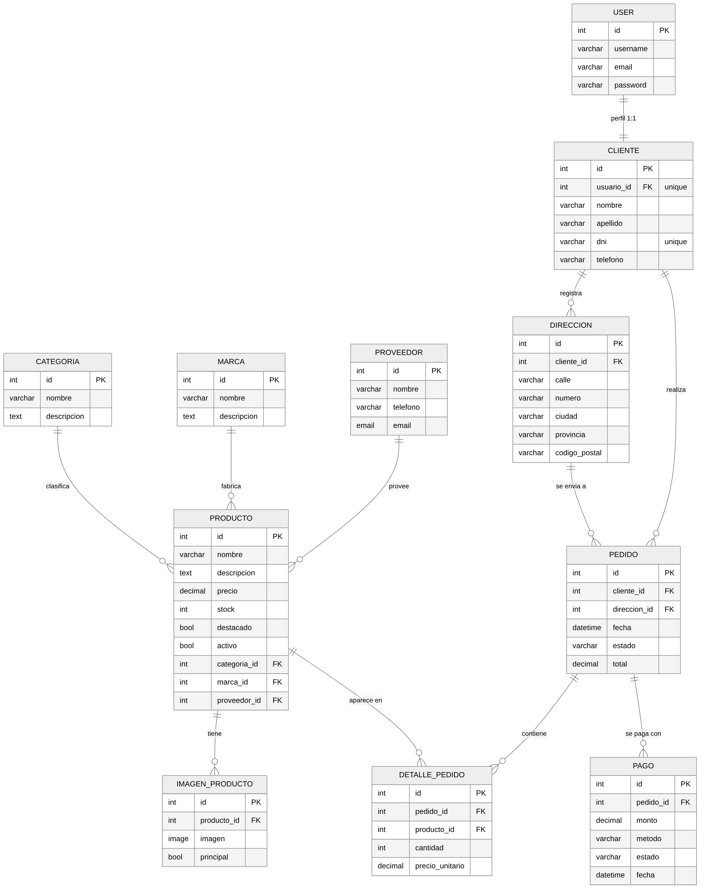

<details>
<summary>Ver el diagrama en formato Mermaid (GitHub lo dibuja automáticamente)</summary>

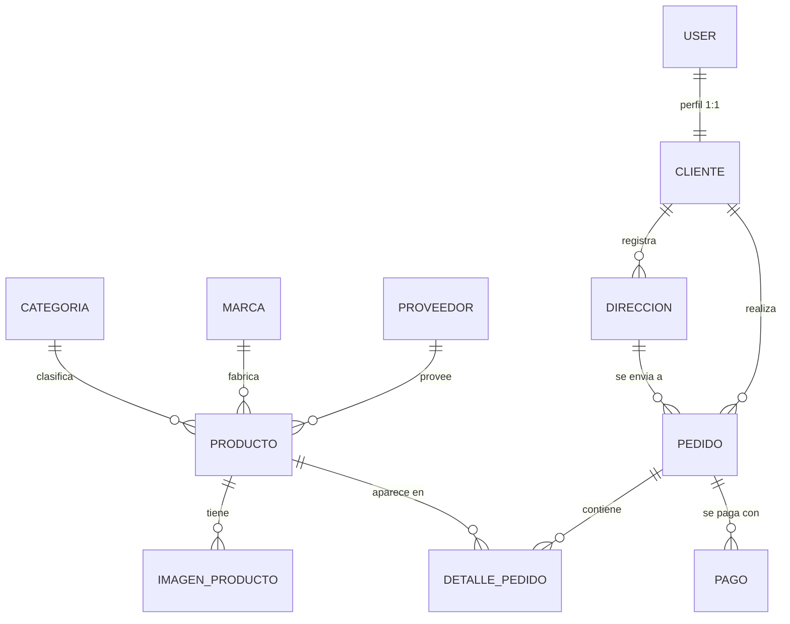

</details>

## Instalación con uv

### Requisitos

- Python 3.12 o superior
- [uv](https://docs.astral.sh/uv/getting-started/installation/)
- Git

Instalar uv (si no lo tienen):

```bash
# Linux / macOS
curl -LsSf https://astral.sh/uv/install.sh | sh

# Windows (PowerShell)
powershell -ExecutionPolicy ByPass -c "irm https://astral.sh/uv/install.ps1 | iex"
```

### Pasos

```bash
# 1. Clonar el repositorio
git clone <url-del-repositorio>
cd lumen-optica-backend

# 2. Crear el entorno virtual e instalar las dependencias (usa uv.lock)
uv sync

# 3. Aplicar las migraciones (crea db.sqlite3)
uv run python manage.py migrate

# 4. Crear un superusuario para el admin y para pedir tokens
uv run python manage.py createsuperuser
```

> `uv sync` crea la carpeta `.venv/` automáticamente. No hace falta activarla: `uv run` ejecuta los comandos dentro del entorno.

## Cómo ejecutar el proyecto

```bash
uv run python manage.py runserver
```

Luego abrir en el navegador:

| URL | Qué muestra |
|---|---|
| http://127.0.0.1:8000/ | Página de inicio con accesos rápidos |
| http://127.0.0.1:8000/api/ | Raíz de la API navegable (DRF) |
| http://127.0.0.1:8000/api/docs/ | Swagger UI |
| http://127.0.0.1:8000/api/redoc/ | Redoc |
| http://127.0.0.1:8000/admin/ | Panel de administración |

Otros comandos útiles:

```bash
uv run python manage.py makemigrations   # después de modificar modelos
uv add <paquete>                         # agregar una dependencia
```

## Autenticación

La API usa **JWT (JSON Web Tokens)** con `djangorestframework-simplejwt`, y también acepta la sesión del admin de Django (útil al probar desde la API navegable).

**Permisos:** hay dos niveles, según si el recurso tiene datos personales o no.

| Recursos | Permiso | Lectura (`GET`) | Escritura (`POST`, `PUT`, `PATCH`, `DELETE`) |
|---|---|---|---|
| Catálogo: categorías, marcas, proveedores, productos, imágenes | `IsAuthenticatedOrReadOnly` | Pública, sin token | Requiere token |
| Datos sensibles: clientes, direcciones, pedidos, detalles de pedido, pagos | `IsAuthenticated` | Requiere token | Requiere token |

Sin token, cualquier operación protegida responde `401 Unauthorized`. Así el catálogo se puede mostrar en una tienda pública, pero los datos de clientes (DNI, direcciones) y de ventas quedan protegidos.

### 1. Obtener el token

```http
POST /api/token/
Content-Type: application/json

{
  "username": "admin",
  "password": "tu_contraseña"
}
```

Respuesta:

```json
{
  "refresh": "eyJhbGciOiJIUzI1NiIs...",
  "access": "eyJhbGciOiJIUzI1NiIs..."
}
```

### 2. Usar el token

Enviar el `access` en el encabezado `Authorization` de cada petición:

```bash
curl -X POST http://127.0.0.1:8000/api/categorias/ \
  -H "Authorization: Bearer <access>" \
  -H "Content-Type: application/json" \
  -d '{"nombre": "Lentes de lectura", "descripcion": "Lentes con aumento"}'
```

### 3. Renovar el token

El `access` dura poco (5 minutos por defecto). Para obtener uno nuevo sin volver a enviar usuario y contraseña:

```http
POST /api/token/refresh/
Content-Type: application/json

{ "refresh": "<refresh>" }
```

En **Swagger** se puede usar el botón **Authorize**, pegar el token `access` y probar los endpoints protegidos desde el navegador.

## Endpoints principales

Base: `http://127.0.0.1:8000/api/`

Todos los recursos son `ModelViewSet`, así que cada uno expone el CRUD completo:

| Método | Ruta | Acción |
|---|---|---|
| GET | `/api/<recurso>/` | Listar (paginado) |
| POST | `/api/<recurso>/` | Crear 🔒 |
| GET | `/api/<recurso>/{id}/` | Ver detalle |
| PUT / PATCH | `/api/<recurso>/{id}/` | Modificar 🔒 |
| DELETE | `/api/<recurso>/{id}/` | Eliminar 🔒 |

🔒 = requiere token JWT. En los recursos marcados como **privados** en la tabla siguiente, también el `GET` requiere token.

### Recursos

| Recurso | Ruta | Lectura |
|---|---|---|
| Categorías | `/api/categorias/` | Pública |
| Marcas | `/api/marcas/` | Pública |
| Proveedores | `/api/proveedores/` | Pública |
| Productos | `/api/productos/` | Pública |
| Imágenes de producto | `/api/imagenes-producto/` | Pública |
| Clientes | `/api/clientes/` | Privada 🔒 |
| Direcciones | `/api/direcciones/` | Privada 🔒 |
| Pedidos | `/api/pedidos/` | Privada 🔒 |
| Detalles de pedido | `/api/detalles-pedido/` | Privada 🔒 |
| Pagos | `/api/pagos/` | Privada 🔒 |

### Endpoints especiales

| Método | Ruta | Descripción |
|---|---|---|
| GET | `/api/productos/destacados/` | Lista los productos con `destacado=true` (sin paginar) |
| POST | `/api/pedidos/{id}/cancelar/` 🔒 | Cambia el estado del pedido a `cancelado` |
| POST | `/api/token/` | Obtener tokens `access` y `refresh` |
| POST | `/api/token/refresh/` | Renovar el token `access` |
| GET | `/api/schema/` | Esquema OpenAPI 3 (YAML) |

### Búsqueda, filtros y orden en productos

| Parámetro | Ejemplo | Descripción |
|---|---|---|
| `categoria` | `/api/productos/?categoria=1` | Filtra por ID de categoría |
| `marca` | `/api/productos/?marca=2` | Filtra por ID de marca |
| `destacado` | `/api/productos/?destacado=true` | Solo destacados |
| `activo` | `/api/productos/?activo=true` | Solo activos |
| `search` | `/api/productos/?search=ray` | Busca en `nombre`, `descripcion` y nombre de la marca |
| `ordering` | `/api/productos/?ordering=-precio` | Ordena por `nombre`, `precio` o `stock` (`-` = descendente) |
| `page` | `/api/productos/?page=2` | Paginación de 10 resultados por página |

Los parámetros se pueden combinar, por ejemplo: `/api/productos/?categoria=1&search=ray&ordering=precio`.

### Formato de las respuestas

- En el **listado** de productos, `categoria` y `marca` vienen anidadas como objetos; en el **detalle** vienen como IDs.
- En el **listado** de pedidos, `cliente`, `direccion` y `detalles` (con su producto) vienen anidados, para mostrar el pedido completo en una sola petición.
- Para **crear o modificar** se envían los IDs de las relaciones:

```json
POST /api/productos/
{
  "nombre": "Ray-Ban Aviator Classic",
  "descripcion": "Anteojos de sol con lentes verdes",
  "precio": "189000.00",
  "stock": 12,
  "destacado": true,
  "activo": true,
  "categoria": 1,
  "marca": 1,
  "proveedor": 1
}
```

```json
POST /api/pedidos/
{ "cliente": 1, "direccion": 1, "estado": "pendiente", "total": "0.00" }

POST /api/detalles-pedido/
{ "pedido": 1, "producto": 1, "cantidad": 2, "precio_unitario": "189000.00" }

POST /api/pagos/
{ "pedido": 1, "monto": "378000.00", "metodo": "tarjeta", "estado": "aprobado" }
```

## Panel de administración

Se ingresa en http://127.0.0.1:8000/admin/ con el usuario creado con `createsuperuser`. Solo pueden entrar cuentas con permisos de **staff**; no se debe habilitar el acceso anónimo.

Desde el panel se administran categorías, marcas, proveedores, productos, imágenes, clientes, direcciones, pedidos, detalles y pagos. Para agilizar la carga:

- Las **imágenes** se editan dentro del formulario del **producto**.
- Los **detalles** y los **pagos** se editan dentro del formulario del **pedido**.
- Los listados tienen búsqueda y filtros (por ejemplo, productos por categoría, marca, destacado y activo; pedidos por estado y fecha).

## Documentación: Swagger y Redoc

La documentación se genera automáticamente con **drf-spectacular** a partir de los modelos, serializadores y vistas, así que siempre está actualizada con el código.

| Herramienta | URL | Para qué sirve |
|---|---|---|
| Swagger UI | `/api/docs/` | Probar los endpoints desde el navegador ("Try it out"). Con **Authorize** se carga el token JWT. |
| Redoc | `/api/redoc/` | Leer la documentación ordenada por recurso, con ejemplos de respuesta. |
| Esquema OpenAPI | `/api/schema/` | Descargar el archivo OpenAPI 3 (sirve para importar en Postman, Insomnia, etc.). |

Se usa `drf-spectacular-sidecar`, por lo que los archivos de Swagger y Redoc se sirven desde el propio proyecto y funcionan sin conexión a internet.

## Pruebas

```bash
uv run python manage.py test
```

Las pruebas cubren:

- Registro y acceso al panel de administración.
- Permisos de la API: lectura pública del catálogo, datos sensibles y escrituras solo con autenticación.
- Disponibilidad de Swagger, Redoc y el esquema OpenAPI.
- Configuración de CORS y variables de entorno.

Con Docker se ejecutan contra PostgreSQL: `docker compose exec web python manage.py test`.

## Ejecutar con Docker

Requisitos: Docker Engine + Docker Compose v2.

```bash
cp .env.example .env        # y cambiar POSTGRES_PASSWORD
docker compose up -d --build
docker compose ps           # db y web en "healthy"
```

Al arrancar, `web` espera a que `db` esté lista, aplica las migraciones automáticamente y levanta gunicorn.

Una vez levantado:

| URL | Qué muestra |
|---|---|
| http://127.0.0.1:8000/api/ | API |
| http://127.0.0.1:8000/api/docs/ | Swagger |
| http://127.0.0.1:8000/admin/ | Admin |

Crear un administrador:

```bash
docker compose exec web python manage.py createsuperuser
```

**Servicios que levanta:**

| Servicio | Contenido |
|---|---|
| `web` | Django + gunicorn |
| `db` | PostgreSQL 15 (sin puerto publicado) |

**Detener:**

- `docker compose down` conserva los datos.
- `docker compose down -v` los borra.

Sin Docker el proyecto funciona igual: `uv run python manage.py runserver` (usa SQLite).

Detalle y variables de entorno: [docs/docker.md](docs/docker.md).

### CORS

Para que un frontend pueda consumir la API desde otro origen se usa `django-cors-headers`. Los orígenes permitidos se configuran con la variable de entorno `DJANGO_CORS_ALLOWED_ORIGINS` en el archivo `.env`, separados por coma. Por defecto son `http://localhost:3000` y `http://127.0.0.1:3000`, pensados para un frontend local. Las demás variables están explicadas en [docs/docker.md](docs/docker.md).

## Capturas del sistema

### Página de inicio
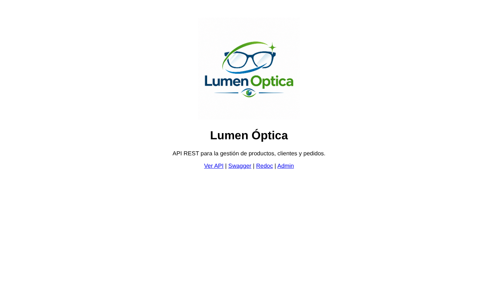

### API navegable — raíz
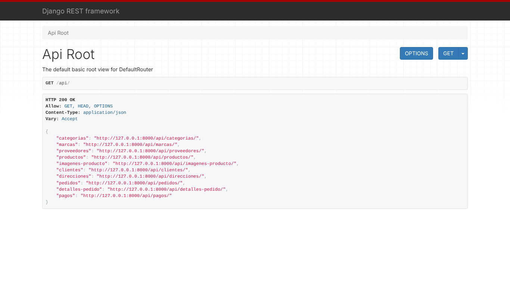

### Listado de productos
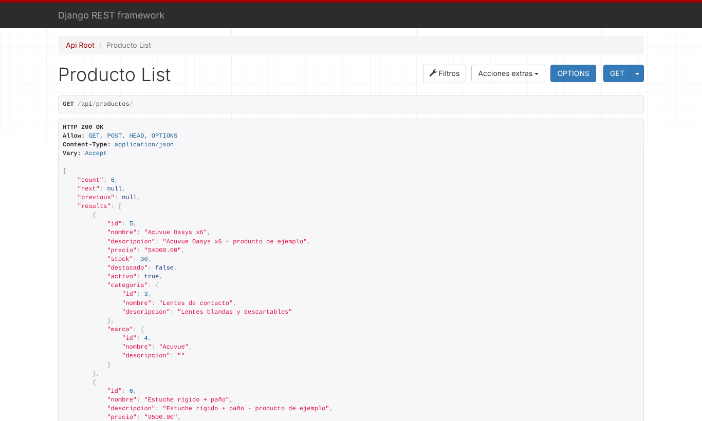

### Swagger UI
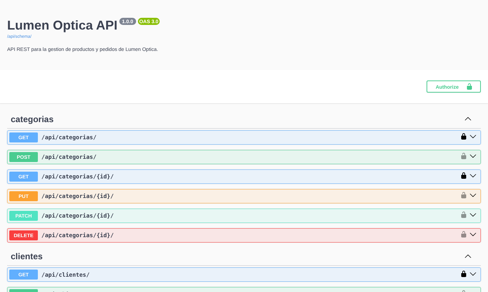

### Redoc
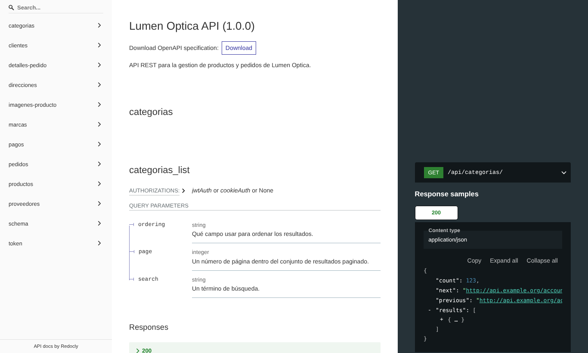

### Obtención de token JWT
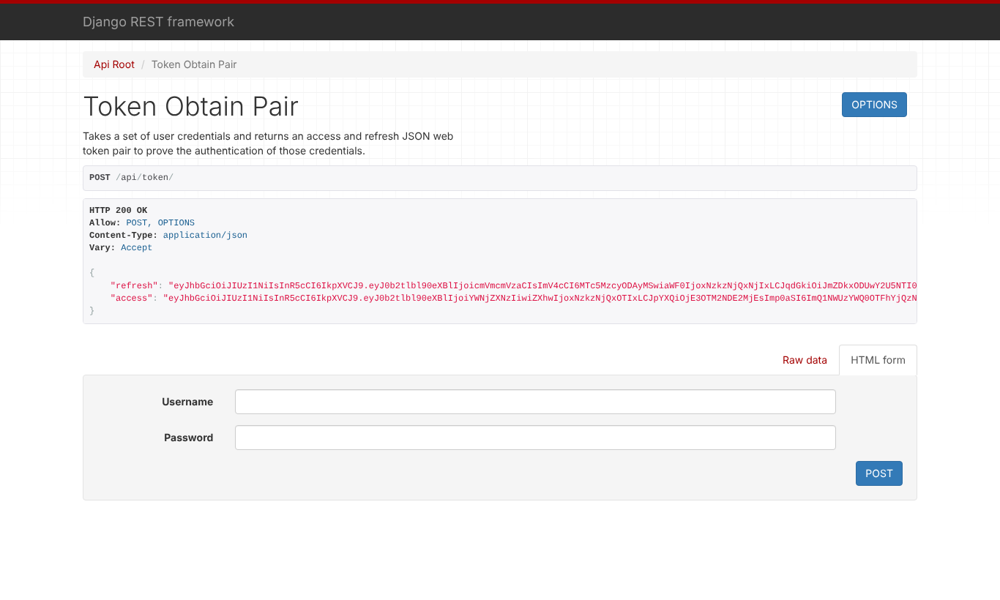

### Panel de administración
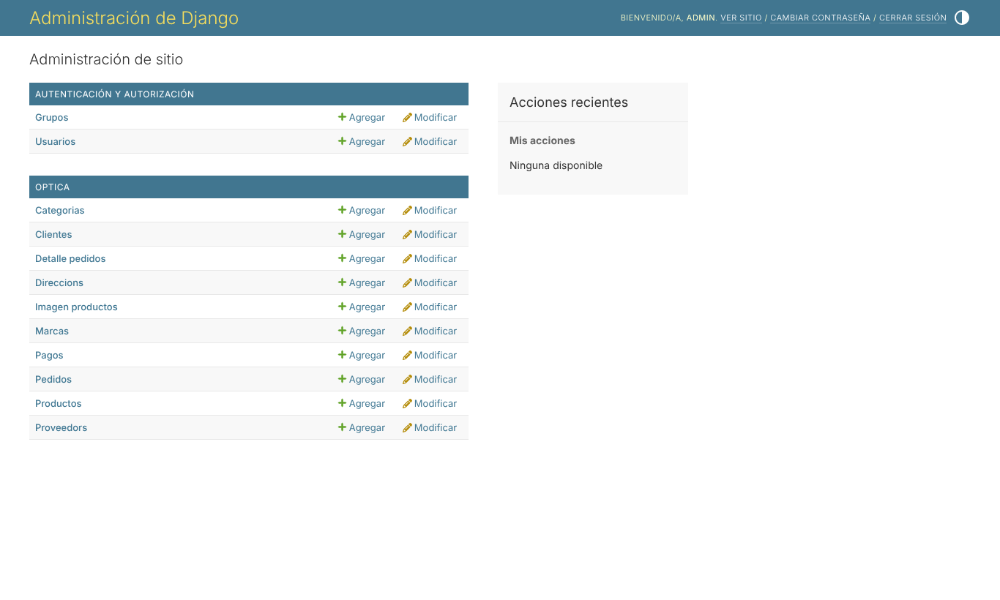

### Admin — productos con filtros
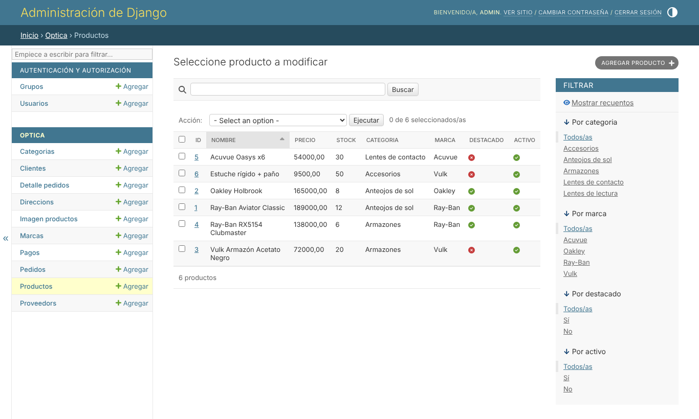

### Admin — pedidos
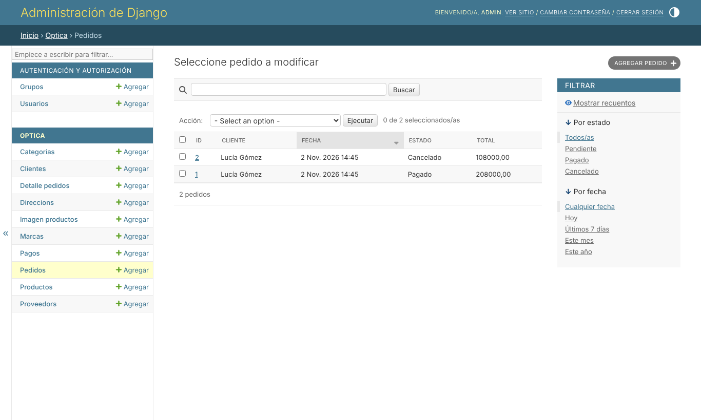

## Flujo de trabajo con Git

- `main`: versión estable. **No se trabaja directo en `main`.**
- `develop`: rama de integración.
- `feature/*`: una rama por tarea, que se integra a `develop` mediante Pull Request.

```bash
git checkout develop
git pull
git checkout -b feature/mi-tarea
# ...cambios...
git add .
git commit -m "Descripción del cambio"
git push -u origin feature/mi-tarea
# Abrir Pull Request: feature/mi-tarea → develop
```

| Rama | Responsable | Tarea |
|---|---|---|
| `feature/api-principal` | Integrante 1 | API principal |
| `feature/docker-cors` | Integrante 2 | CORS y Docker |
| `feature/readme-diagrama` | Integrante 3 | README, diagrama y capturas |
| `feature/admin-documentacion` | Integrante 4 | Admin, Swagger/Redoc y pruebas de endpoints |

## Integrantes

| Integrante | Nombre | Usuario de GitHub | Rol |
|---|---|---|---|
| 1 | Candela Picco | `candePicco` | Creación del repositorio y estructura base del proyecto |
| 2 | Mateo Johnston | `mateoJk` | CORS y Docker |
| 3 | Federico Ramirez | `federamirezz` | README, diagrama de modelos y capturas |
| 4 | Juan Laporte | `JLaporte1` | Admin, Swagger/Redoc y pruebas de endpoints |
